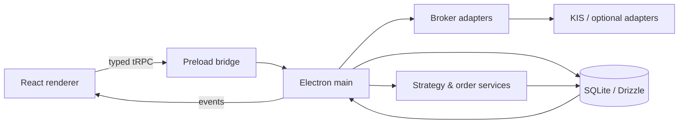

# split-stock

한국투자증권 KIS를 중심으로 **N분할 매수·차수별 독립 익절** 전략을 모델링한 Electron 데스크톱 트레이딩 클라이언트입니다. 관심종목, 포지션, 분할 차수, 주문·체결, 차트와 리포트를 하나의 로컬 앱에서 관리합니다.

> 연구·개발용 프로젝트입니다. 실거래 성과를 주장하지 않으며, 실제 계정으로 실행하기 전에 모의환경·자격증명·주문 제한을 직접 검증해야 합니다.

## 주요 기능

- **분할매매 상태 모델** — 종목별 N차 매수와 차수별 익절 상태를 독립적으로 추적합니다.
- **Desktop trading workspace** — 관심종목, 포지션, 주문, 체결, 호가, 차트, 거래내역을 구성합니다.
- **Market adapters** — KIS의 MOCK/PROD 경계를 분리하고 Upbit·Kiwoom adapter 확장 구조를 포함합니다.
- **로컬 원장** — SQLite와 Drizzle ORM으로 계정·전략·주문·차수·이벤트를 저장합니다.
- **Typed IPC** — renderer가 증권사 API를 직접 호출하지 않고 preload/tRPC를 통해 main process에 요청합니다.
- **분석 UI** — candlestick chart, trade marker, drawing tool, daily P&L과 차수별 통계를 제공합니다.
- **운영 가시성** — data freshness, market session, error/event log, position mismatch를 화면에 노출합니다.

## 아키텍처



| 계층 | 책임 |
|---|---|
| Renderer | FSD 기반 화면, chart, watchlist, settings, reports |
| Preload | context-isolated typed bridge |
| Main | broker I/O, 주문 orchestration, local persistence |
| Shared | Zod contracts, market rules, lot calculation |

## 안전 경계

- 자격증명은 Electron `safeStorage`로 암호화해 로컬 SQLite에 저장합니다.
- App Key·Secret·Token은 로그에서 masking합니다.
- broker 주문 호출은 main process에서만 수행합니다.
- `MOCK`/`PROD` 상태를 명시적으로 구분하고 production 전환 확인 UI를 둡니다.
- Zod contract로 IPC·broker request/response 경계를 검증합니다.
- 공개 저장소에는 실제 API key, 계좌번호, 주문·체결 이력이 포함되지 않습니다.

## 기술 스택

| 영역 | 기술 |
|---|---|
| Desktop | Electron 41, electron-vite |
| Frontend | React 19, TypeScript, TanStack Router/Query, Zustand |
| IPC | tRPC 11, trpc-electron, Zod, SuperJSON |
| Data | SQLite, better-sqlite3, Drizzle ORM |
| Chart/UI | Lightweight Charts, Framer Motion, Floating UI |
| Quality | Vitest, Playwright Electron, Biome, TypeScript project references |

## 로컬 실행

준비물: Node.js 20 이상, Corepack

```bash
corepack enable
pnpm install --frozen-lockfile
pnpm rebuild
pnpm dev
```

기본 검증:

```bash
pnpm typecheck
pnpm lint
pnpm test
pnpm test:e2e
pnpm build
```

`better-sqlite3`는 Node와 Electron의 ABI가 다르므로 test와 desktop 실행 사이에 manifest의 rebuild script를 사용합니다.

## 저장소 구조

```text
src/main/       Electron bootstrap, broker, order, DB, security
src/preload/    context-isolated IPC bridge
src/renderer/   FSD pages, widgets, features, entities, shared UI
src/shared/     contracts, market rules, lot calculation
playwright/     Electron end-to-end scenarios
drizzle/        additive local schema migrations
```

## 현재 범위

- 이력서·포트폴리오용 source project이며 hosted demo는 제공하지 않습니다.
- 실제 broker 환경은 계정·시장·규정에 따라 결과가 달라질 수 있습니다.
- 자동매매는 손실 가능성이 있으며 코드와 테스트가 투자 안전을 보장하지 않습니다.
